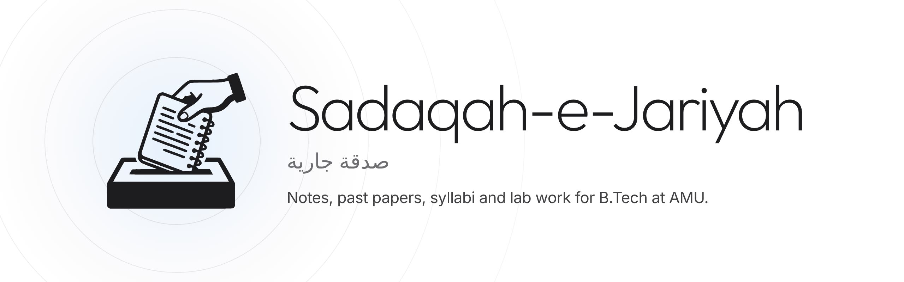

# Sadaqah-e-Jariyah
To create a legacy of continuous benefit (Ṣadaqah-e-Jāriyah) through knowledge, service, and community contributions among AMU B.Tech students.

> The humblest branch of faith is removing an obstacle from a path.

### Objective:
* Someone should pave the path for other who may follow it.
* For a proffessional course the burden of academics should be easied.

### Note:
* Every name, address, folder strucuture should be maintained structurally well defined so that it may easily be parsed.
* Someone elses' time shouldn't be wasted.
    * The website should be easily navigatable
    * Simple in structure and features
    * PRs are always welcomed
* Try not to repeat yourself/data
* It should be so that everything may be changed using PRs.
    * Links, Books, Syllabus, Youtube Playlists, etc all should be such that a single PR may chnage its link.
* It should remain open source.
    * The enire database with all the files should be made public, and should be publically maintainted.
    * If anyone requires the data to continue the sadaqah legacy, he shouldn't need to scrap a single bit of data from the website.
    * The whole database should be reduced into a single JSON file that may be downloaded.
    * The whole database should also be readily available in a cloud service folder.
    * 3-2-1 BackUp rule should be maintained
* Try not to make it complex for your average user.
* Credits should be mentioned.
* Books, or even a single trace of copy righted contents should not exist on the website.
* Codes & questions should be mentioned in the website for lab work.
* Scrapping or data from other websites will only be used after some legitimate verifyable confirmation.
    * Scrapper python files shouldn't be included - as it would increase traffic on their websites

* For ever branch:
    * Curriculum should be mentioned

* Meta-Data for notes like:
    * Author
    * Year
    * Teaching Professor

* For every course:
    * Syllabus
    * Books with reference to Maulana Azad's Books Catalogue with front page as well
    * Some advice from seniors if needed

* For Labs:
    * Lab Location and Lab Name - The specific name that is written on the top of the door
    * Lab Report pdf / Codes
    * Questions
    * Other recommended Lab mannuals links/mentions/front page
    * Viva Questions
    

* For every Unit:
    * Recommended youtube lectures should be included
    * Notes
    * Syllabus

* Mosques times:
    * Dhuhr and Friday times usually don't change in India.
    * Only write the official prayer time

Dhuhr:
| Building/Name | Location | Time |
|--|--|--|

Dhuhr Extra on Ramadan:
| Building/Name | Location | Time |
|--|--|--|
| Engineering College Main Building | Link | 13:45 |

Fridays:
| Building/Name | Location | Khutbah-Time |
|--|--|--|
| Zubair - New Sir Syed Nagar | Link | 14:00 | 

* Even simple things like guide to calculator should be provided.
    * I myself found that students didn't even know that inverse of matrices, matrix algebra, differentiation, integration, solving equations, filling observation tables using formulae, vectors, imaginary numbers, DFT all can be calculated using calculators.
    * In workshops some didn't even put the cells in battery holders the right way.

* If needed pages and links may be separated like:
    * Syllabus page that directs to the website you are going to find the syllabus
    * Syllabus link should direct to the pdf link it self.

* Forms for quick servies and their links should be provided with the procedure that they may need.
    * Procedure/forms for getting transcripts
    * Improvement, re-check, etc
    * NOC

* Adjectives that would introduce things to  someone new:
    * Like instead of just having the common page for first year in the website, setting someone wondering if his branch's first year is different. Calling the page as **First Year (Common).**

* Map that would give the google maps link with coordinates and [floor number, Crop this image or use like it](data:image/gif;base64,R0lGODlhAQABAIAAAP///////yH5BAEKAAEALAAAAAABAAEAAAICTAEAOw==) (always mentioning the ambiguity with a hyperlink to British Floor Numering) with saying like electronics lab is right besides the physics lab. So that someone who has gone to the physics lab in first year may go to the right lab in his second.

* For all the servies that uni provides, an exposure can be given like:
    * Giving the respective book links from the Maulana Azad's Catalogue

* Futures Ideas that deserve integrating:
    * AMU Prayer App: That would update have the updated timings for all the 5 daily prayers in the mosques in AMU and in New Sir Syed Nagar.

Made using prompts with care. 😜